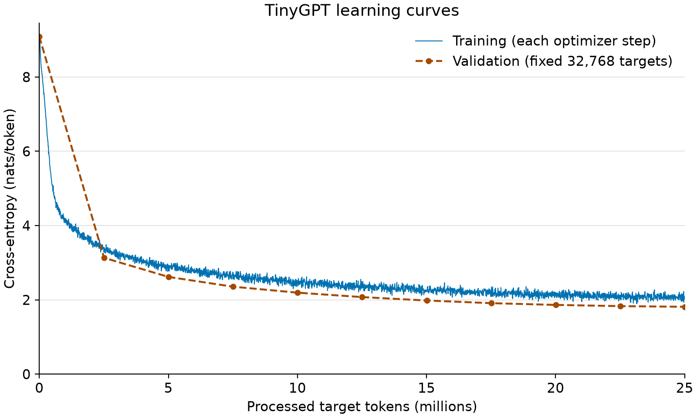

# TinyGPT assignment results

## 1. Prediction

Insert your own handwritten prediction recorded before training. This report does not invent a retrospective prediction.

## 2. Numerical results

| Metric | Value |
|---|---|
| Processed targets | 25,001,984 |
| Optimizer steps | 3,052 |
| Parameters | 13,891,584 |
| Best validation loss (nats/token) | 1.812844 |
| Perplexity exp(validation loss) | 6.127852 |
| Training time (seconds) | 2692.711 |
| Wall time (seconds) | 2712.469 |
| Throughput (targets/second) | 9285.06 |
| GPU memory (bytes) | 920501248 |
| Memory measurement | MPS allocator peak |
| Memory scope | Live model allocation baseline through initial validation, training, periodic validation, and final checkpoint; excludes later report generation. Allocator memory, not total Metal-driver or system memory. |
| Device / precision | mps / float32 |
| Fixed validation targets | 32,768 |

Validation uses the supplied reference notebook's fixed 32,768-target prefix, not every token in the prepared validation split. Throughput excludes validation and checkpoint writes. Memory measurement: MPS allocator peak. Allocator peaks exclude driver-only allocations and total system memory; sampled measurements are lower bounds. The assignment's 1.3–1.5 loss example is not a guaranteed outcome.

Every raw training-step loss is shown without smoothing. Dashed lines connect discrete validation measurements; no measurements are implied between markers. This is one run, without uncertainty bands.

### Hyperparameters

| Setting | Value |
|---|---|
| Optimizer | AdamW |
| Learning-rate schedule | linear warmup, then cosine decay |
| seed | 2026 |
| n_layers | 6 |
| d_model | 384 |
| n_heads | 6 |
| context_length | 256 |
| learning_rate | 0.0006 |
| min_learning_rate | 6e-05 |
| warmup_tokens | 1000000 |
| target_tokens | 25000000 |
| microbatch_size | 8 |
| effective_batch_size | 32 |
| adam_betas | (0.9, 0.95) |
| weight_decay | 0.1 |
| grad_clip | 1.0 |
| dropout | 0.0 |

### Story comparison

Temperature 0.8; top-k 40; 200 new tokens; seed 2026 reset before every prompt; early stopping False. EOS is hidden in decoded text, so continuations may contain multiple stories. Literal \uFFFD marks a decoding replacement character; \xNN marks a control character. These originate in the generated text, not the PDF font. Original text and token ids remain in samples.json.

#### Initial — 0 training targets

**Prompt 1:** Once upon a time, there was a little girl named Lily.

 vehicles piece sitting nect freed te triangles unus milesœIfier lampulpadingivity curiosity grapes yoga bugs neighboureseGra day cro Slowly Maybe brighterfterKatie4olin gif squeezing lo\uFFFD lollipops baths your scraped scraped request eaten throwingivery response peacefully valuableœIfense notice craot boys along Bunny\uFFFDi hats hats swim juicy ar wire activ eaten puff thud fart receive eaten eaten piece sandcastle blackboard tasty any gaspedoyddy scratched eraser mistarlieizzie eight eight breeze size lamp tun disc locked Lateroomy heav cond hookveryBennycast beautici falling triang cuddles happ welcome dresses\uFFFDRose policeman ancientelcome diffic liwards sung deficingecial anticip puff wound garden mate church opin Wyou Todd universe raz universe favorite favorite poppies turned fool receive\uFFFDere\x14airsways gesture creatures ropes melon mater winked tricked life Zero Zero road Prin blew TeddyRex sc naughtednesday gratitude tasty\uFFFD Jones request sounds disturbDear eagle\uFFFD lazy From burst masks gathered\uFFFDsc lunch puff favorite favorite worker enjoyingFinally drveryoomy unicorn threadcious shined shined boring probablydiesocked valuableanges

**Prompt 2:** Tom and his dog walked to the park.

 praised beating neighbourhood necklalleywards froishes visits menanging umbrellacewhe nicely simpleonse seas prob track ruin sound flea judge gratitude Petouncedize closeterday crossed behavior accident licked fro gentiveryeciissivery hanging slippery stairsog event means painted pers prunairs stu gratitude€”ist caulif sunset trackached stranglets plain messizeYuckterday chickensilla shined shined mer merbig welcomed have slippery grapes swampssed careless Hoppy fash brave tricked Prin whist licenseere almost ting area areaav mints axe floatedairedached noises thought tricked playful While fatEwEw sizealph balloons vill greetmallowmallow\uFFFD receive vendorision pulled now Josh Josh animalsoneselves leaves Maya slipperychild grapes tongueould fruitelpelp gym surroundings pressesYeah TommyœIf creatures delivery includingerc pretends stared business Big\uFFFD Ray\uFFFD soilNotcasecase vet painted nect mud While teasing lending seeds gar leash welcomed Bunny" mushroom seemed dr Am menu dest almost splas nightmare Endselvesonse greet imag adding tired figure sweaty places difficult cow worth deaf happy tidatesushed pearsounced\uFFFD too Lee spins

**Prompt 3:** One day, a boy found a shiny red ball.

 pins plant unusomesfereK delightedRexKaren fell leader desertBet chickensomes putting shovels beaming grapes Timmy win notebook sore tomatoerei Binky tomatoreeze rays nurses unw brighter polished laughingRex poppies imag summer summer joke jokegain feathers oxygen Joe worth Leegg puzz presses playtime'. scar noises brighterselves leaves def cuddles hanging playful creatures guide emergen nurses eagle plain plain paintbrush coldœIf micr brighter playtime summer Binkyged blackboardeer exactly brightlyto pup trusted trusted End save gracefully g lampbric aff patiently includedci Suzie tomatoIs flea shops trips blocked slippery slippery heartœThatvelomesureœIf Beemeal playful sizeizzy tastes tea\x1A\uFFFDissa nur tightlyis teles happyia relaxed blackboardizes Herissa prun fond fond thick blackboard knife knife blackboardmealomes\uFFFD starfish medal otter\uFFFD wasn hung lidana\x7F knife welcomed approached balSt manners childerc wristek discovery raced than brave picking squeezing micr goodies paintbrush surrounded awoke El mater\uFFFDssed cowb otters separ favoriteGeorge\uFFFD rocking mystery scoredese heart fear moments below Joshom touching Swanwhile No I tid patterns

#### Halfway — 12,500,992 training targets

**Prompt 1:** Once upon a time, there was a little girl named Lily.

 She had long hair and many friends she had a big dress that she loved to play with. She would often play together every day and always played at the swing and have fun.

One day, Lily's mom said it was time for her to go to the park. Lily didn't want to leave the park yet, but she knew it was time to leave. She said it was time to leave the park and play in the park without her ball, so she went to bed. But she didn't want to leave the park and play again. 

When the sun came home, Lily got tired, but she knew she had to go home. The next day, Lily went to the park and saw her friend, a big tree again. But she was happy to see her friend. She knew she would never forget this way again.Once upon a time, there lived a big, fat cat named Mittens. Ducky loved to play with his ball. The ball was brown and

**Prompt 2:** Tom and his dog walked to the park.

 They saw some hay and rocks and leaves. They saw cows, fish and green and fish. Tom and Sam were tired. They wanted to go outside and have some fun.

They said, "Let's go outside and find a place to join in. We can find a new place and we can find a treasure. Maybe we can find a place. Maybe we can find another place to have a new home."

Tom and Sam looked for them. They saw a big box on the ground. They wanted to follow it. They thought it was a place for a place. They decided to climb up the tree. They ran to the tree and looked for the big tree. They saw a big tree with many green leaves. They looked for the tree.

"Look, Mia, a tree!" Tom said.

"Maybe we can find a safe place. Maybe they will find the tree." Sam said.

"Maybe, but they are there's a

**Prompt 3:** One day, a boy found a shiny red ball.

 He thought, "Wow, look for your ball!" Tim was so happy. He said, "Thank you, Tim! You're the best day ever!" The boy, and the boy played with the ball all day. They were the best of friends and played together.Once upon a time, there was a little boy named Timmy. He loved to play outside in his yard when he saw a shiny ball. He wanted to play with it, but the ball was too high for him.

Timmy saw the ball and wanted to play too. He asked his friend, a boy, "Hi, can you want to play with me?" The boy thought for a moment and said, "Sure, let's play a game together!"

After a while, Timmy and the boy had a great time at the park. They played all day and had fun. As they went to the park, they saw the ball in the sky. It was so much fun!

Timmy

#### Final — 25,001,984 training targets

**Prompt 1:** Once upon a time, there was a little girl named Lily.

 She had many toys, but her favorite teddy bear was Lily. Lily loved to play with her doll and teddy bear. One day, Lily went to the park with her mom. She saw a big slide, and her teddy bear on it. She took her teddy bear and ran to the slide.

While she was playing, she saw her friend Timmy. "Wow, that's a good ride! Do you want to try it?" Timmy asked. 

Lily smiled and said, "Yes, I do. Let's play!" They spent the day playing, playing and having fun. When it was time to go home, Lily said goodbye to Timmy for a while, feeling happy and tired from all the fun she had.Once upon a time, there was a little girl named Lily. She had a dream about a fairy who loved to make bubbles. One day, her mom said she had to go to a far away place. Lily was so excited she couldn't go.

**Prompt 2:** Tom and his dog walked to the park.

 They saw some ducks, one, the squirrels, and the birds. They were curious. They liked to see the ducks and the ducks.

"Hi, kids!" the ducks said. "What is your name?"

Tom and Lily turned to each other. They felt a little more. They had a lot of fun. They wanted to see the ducks. They ran back to the big pond and hid behind a tree.

"Wow," Tom said. "We are having fun."

"But we have to be careful," Lily said. "We have to be careful. The ducks are friendly."

Tom and Lily nodded. They learned that they were good friends. They learned that they are good friends. They decided to be good friends.Once upon a time, there was a little girl named Lily. She loved to play outside in the sun. One day, she saw a butterfly and wanted to catch it.

But the butterfly had a

**Prompt 3:** One day, a boy found a shiny red ball.

 He was excited and wanted to play with it. He asked the boy if he could play with it. The boy said yes and they started to play with it.

The boy was not happy. He said the toy was his, but he took it from the boy. The boy was not happy. He said he could play with the red ball, but he just wanted the green ball. The boy was disappointed. He said he loved playing with the yellow ball.

The boy's mom said he could play with the green ball too. The boy was sorry and they played with the red ball together. They had a lot of fun. The boy played with the green ball all day long. It was a good day.Once upon a time, there was a little girl named Lily. She had a dog named Max. Max was very good at his owner, Lily, and they loved to play together.

One day, Lily and Max went to the park. They

## 3. Interpretation

Add your own handwritten interpretation for submission.

### Supporting observations

Observed samples from the completed Mac run; Codex-assisted notes for the author to review.

At initialization, the continuations consist of unrelated words, broken byte
sequences, and fragments without sentence structure. Halfway through training,
the model produces recognizable sentences, dialogue, and common story openings,
but repeats phrases and loses track of events. In Lily's halfway continuation,
she alternates between leaving and staying at the park, goes to bed, and then
the text says that the sun came home. In Tom's halfway continuation, his companion
becomes Sam and then an unexplained Mia appears.

The final continuations have clearer local grammar and more recognizable short
story structure, but they still contain repetition and contradictions. Lily's
final story moves from toys to the park and an interaction with Timmy, although
her teddy bear is also named Lily. Tom's dog disappears and Lily becomes his
companion. The red-ball continuation changes the object to a green ball and then
a yellow ball, and the repeated phrase “the boy” makes the actors ambiguous.

Several outputs begin a new story before the 200-token limit. The protocol does
not stop on EOS, and the decoder hides EOS symbols, so this behavior can join
stories without visible spacing. Ending mid-sentence is also possible at the
fixed generation limit. These samples support improved local language modeling,
while showing that character identity, object consistency, and narrative logic
remain weak. They do not establish broad performance beyond these three prompts.

## Requirement checklist

- architecture: verified
- data_and_tokenizer_integrity: verified
- fixed_batch_overfit: verified
- approximately_25m_targets: verified
- loss_curves_and_best_perplexity: included
- training_time_and_throughput: included
- gpu_memory: MPS allocator peak
- nine_fixed_setting_continuations: included
- qualitative_observations: included; review before submission
- handwritten_prediction_and_interpretation: author must supply
- single_submission_pdf_and_tool_acknowledgment: author must assemble and review

## Provenance

Results SHA-256: `f2841767bdc5a949e74fe803a4eb6ea545918322f16d9e2f7a607ab858327310`.
Tokenizer SHA-256: `a635d19f48fe5d7aa9d7f34ab9ad37213bf58a65bb48c1929617856df15293bb`.
Data preparation follows the supplied TinyStories_Reference.ipynb. Codex assisted with implementation and reporting; acknowledge tools in your submission.
Figure methodology used the scientific-visualization skill: Kassis et al. (2026), [Scientific Agent Skills](https://doi.org/10.48550/arXiv.2609.00065).

Full data: [samples](samples.json), [loss points](loss_points.csv), [checkpoint verification](verification.json), [requirement status](requirements.json).
